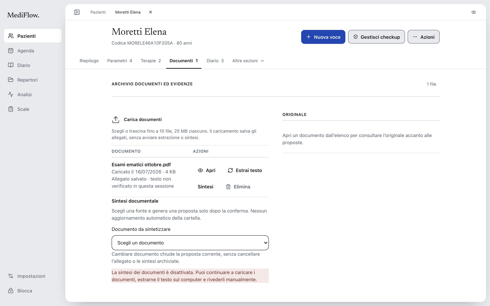
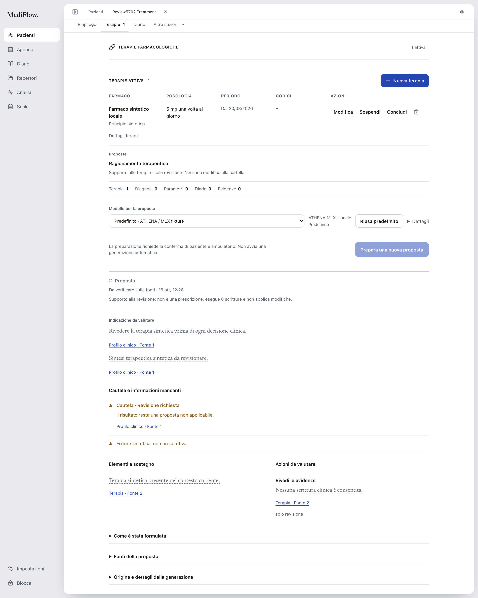

<div align="center">
<picture>
  <source media="(prefers-color-scheme: dark)" srcset="./docs/design/punto-inchiostro/icona/punto-grafite.svg">
  
</picture>

# MediFlow

**Ritrova il filo.**

Un gestionale aperto e gratuito per il lavoro in ambulatorio.<br>
Cartelle, documenti e attività da seguire, anche senza intelligenza artificiale (AI).

[](./CHANGELOG.md#090---2026-10-15)
[](https://github.com/Wulfgardr/mediflow/releases/latest)
[](./LICENSE)
[](#dove-stanno-i-dati)
[](./docs/STATE_OF_THE_SYSTEM.md)

[**Scopri Get MediFlow**](https://getmediflow.dev) · [Perché nasce](#perché-nasce) · [Cosa puoi fare](#cosa-puoi-fare) · [Provalo](#provalo) · [Per chi sviluppa](#per-chi-sviluppa) · [Documentazione](#documentazione)

</div>

MediFlow riunisce la storia del paziente, i documenti e le attività ancora
da seguire. Diario, diagnosi, terapie e misure si consultano nella cartella.
Le funzioni AI sono facoltative e producono proposte da rivedere.

<picture>
  <source media="(prefers-color-scheme: dark)" srcset="./docs/images/getmediflow-090/pazienti-dark.png">
  
</picture>

*Elenco pazienti con dati di esempio. Le 21 immagini sono del 16 ottobre 2026,
[revisione `31d7a3268ff7`](https://github.com/Wulfgardr/mediflow/tree/31d7a3268ff7f38aebad40afc707f6b0b74762b1),
successiva alla 0.9.0. [Provenienza delle immagini](./docs/images/getmediflow-090/manifest.json).*

> **Versione pubblicata: 0.9.0, codice sorgente.**
>
> Comprende l'applicazione Web locale e l'accesso per agenti (Headless), con
> Node 24. È stata provata su macOS Apple Silicon, Windows 11 ARM con Node
> x64 emulato e Omarchy/Arch ARM su Parallels. App native e installer firmati
> non sono inclusi.
>
> Le prove usano dati sintetici. La pubblicazione dei sorgenti non autorizza
> l'uso clinico: l'ammissione dell'installazione e dei flussi spetta al
> professionista o all'organizzazione responsabile.
>
> [Release e verifiche](https://github.com/Wulfgardr/mediflow/releases/tag/v0.9.0) ·
> [Novità successive, non ancora rilasciate](./CHANGELOG.md#non-ancora-rilasciato)

<details>
<summary><strong>Avvio della 0.9.0 e limiti delle verifiche</strong></summary>

L'avvio verificato richiede un checkout Git pulito del tag `v0.9.0` con
Node 24, sui profili indicati sopra. Gli archivi ZIP e TAR.GZ forniti da
GitHub contengono i sorgenti senza `.git`: il loro avvio non è stato qualificato.
Segui il [README del tag](https://github.com/Wulfgardr/mediflow/blob/v0.9.0/README.md).

Le [note 0.9.0](./CHANGELOG.md#090---2026-10-15) e lo
[stato del sistema](./docs/STATE_OF_THE_SYSTEM.md) riportano prove accettate e
limiti. Due cause di instabilità dei test restano in quarantena fino al
23 ottobre 2026 alle 00:00 UTC; i test continuano a essere eseguiti.
Le verifiche valgono per la revisione su cui sono state svolte.

</details>

## Perché nasce

Seguire una persona nel tempo richiede testi clinici, dati strutturati e
documenti originali. MediFlow li tiene nella stessa cartella, per consultare
la storia, ritrovare una fonte e preparare i controlli successivi.

Il gestionale funziona anche senza AI. Si possono aggiungere le funzioni
utili alla propria postazione, con configurazione e verifiche specifiche.
Il codice è aperto e gratuito; hardware, modelli e servizi di terzi possono
avere costi e condizioni proprie.

## Cosa puoi fare

| Attività | Funzioni |
| --- | --- |
| Consultare e aggiornare la cartella | Diario, diagnosi, terapie, misure e dati amministrativi. Le modifiche sono versionate e i conflitti richiedono riesame. |
| Consultare le fonti | Documenti originali collegati alla cartella; estrazione locale per i formati supportati. |
| Organizzare il seguito | Checkup, appuntamenti e attività aperte. |
| Usare termini e cataloghi | ICD-11, catalogo AIFA, esenzioni e protesica. Fonte e versione restano riconoscibili. |
| Registrare le scale | Risposte e storico; lo zero resta distinto dalla risposta mancante. |
| Riesaminare le informazioni con AI | Sintesi del paziente, importazione assistita, sintesi dei documenti e ragionamento terapeutico, sempre come proposte da rivedere. |
| Usare un client agente autorizzato | Comandi MediFlow con autenticazione e permessi specifici, senza accesso diretto al database. |

<details>
<summary><strong>Schermate della cartella e delle attività</strong></summary>

<picture>
  <source media="(prefers-color-scheme: dark)" srcset="./docs/images/getmediflow-090/scheda-dark.png">
  
</picture>

La scheda riunisce quadro clinico, terapie e diario della stessa persona.

<picture>
  <source media="(prefers-color-scheme: dark)" srcset="./docs/images/getmediflow-090/terapie-dark.png">
  
</picture>

Le terapie si consultano nel contesto della cartella.

<picture>
  <source media="(prefers-color-scheme: dark)" srcset="./docs/images/getmediflow-090/diario-dark.png">
  
</picture>

Il diario raccoglie le voci dei pazienti, con fonte e stato di ciascuna.

<picture>
  <source media="(prefers-color-scheme: dark)" srcset="./docs/images/getmediflow-090/agenda-dark.png">
  
</picture>

<picture>
  <source media="(prefers-color-scheme: dark)" srcset="./docs/images/getmediflow-090/repertori-dark.png">
  
</picture>

I repertori indicano quali cataloghi sono disponibili. Nell'esempio AIFA,
esenzioni e protesica sono ancora da importare.

<picture>
  <source media="(prefers-color-scheme: dark)" srcset="./docs/images/getmediflow-090/analisi-dark.png">
  
</picture>

<picture>
  <source media="(prefers-color-scheme: dark)" srcset="./docs/images/getmediflow-090/documents-dark.png">
  
</picture>

Le schermate usano dati di esempio. Quella documentale mostra la revisione,
senza dimostrare l'esecuzione di un modello AI o dell'estrazione del testo.

L'interfaccia segue [Punto d'inchiostro](./docs/design/punto-inchiostro/01-specifica.md).
I [limiti delle verifiche tipografiche](./docs/known-limitations.md#nota-successiva-tipografia-web-ottobre-2026)
sono documentati separatamente.

</details>

<details>
<summary><strong>Cataloghi e scambio dei dati</strong></summary>

ICD-11 include il catalogo WHO MMS 2026-01 in inglese, con ricerca per codice
o titolo e senza connessione Internet. Non include sinonimi e
postcoordinazione dell'API WHO. I dati WHO hanno licenza CC BY-ND 3.0 IGO,
distinta dalla MIT. [Guida ICD-11](./docs/icd-who-setup.md).

Il catalogo AIFA si importa da file o con **Aggiorna ora**. Con il consenso
Internet AIFA, l'apertura di Repertori controlla gli aggiornamenti al massimo
una volta al giorno; l'installazione resta esplicita.
[Guida AIFA](./docs/MANUALE.md#catalogo-farmaci-aifa).

La protesica supporta fonti personali, documenti originali e provenienza
nelle nuove prescrizioni scelte dal catalogo. Importa file CSV; per XLSX
serve prima l'esportazione in CSV. Catalogo, originali e copie della
provenienza sono in chiaro nel database locale.
[Guida protesica](./docs/MANUALE.md#fonti-personali-della-protesica).

I percorsi SISS/FSE accompagnano l'utente verso i canali ufficiali e non sono
integrazioni regionali. L'esportazione FHIR segue il
[contratto ADR 0081](./docs/adr/0081-fhir-r4-export-v0-contract.md);
la parità FHIRv2 resta da verificare.

</details>

### Funzioni AI facoltative

Intelligence Fabric coordina quattro funzioni:

- **Patient Insight:** sintesi del contesto del paziente.
- **Smart Import:** proposta di dati strutturati a partire da una fonte.
- **Document Synthesis:** sintesi del contenuto dei documenti.
- **Treatment Reasoning (Ragionamento terapeutico):** supporto al riesame della terapia.

Ogni risultato resta una proposta da rivedere; nessuna proposta modifica
la cartella automaticamente. Si scelgono solo modelli ammessi dal sistema
locale, per funzione o singola richiesta. Un modello assente o non più
valido non viene sostituito automaticamente.

Ollama può eseguire le prime tre funzioni. ATHENA/MLX è facoltativa e
riservata al ragionamento terapeutico, con modello e configurazione locali.

<picture>
  <source media="(prefers-color-scheme: dark)" srcset="./docs/images/getmediflow-090/modelli-locali-dark.png">
  
</picture>

Collegare Ollama richiede una scelta esplicita. La verifica della connessione
legge l'elenco dei modelli e non genera testo.

<picture>
  <source media="(prefers-color-scheme: dark)" srcset="./docs/images/getmediflow-090/ragionamento-terapeutico-dark.png">
  
</picture>

*Esempio di ragionamento terapeutico con risposta simulata, senza esecuzione
di un modello. [Provenienza](./docs/images/getmediflow-090/manifest.json).*

I servizi esterni, compresa l'integrazione ChatGPT, sono spenti per
impostazione predefinita. Richiedono configurazione, consenso e controlli
sui dati da inviare. Collegare un account ChatGPT non fornisce accesso alle
API OpenAI e non attesta l'idoneità all'uso con dati clinici reali.

<details>
<summary><strong>Fonti, permessi e invio a servizi esterni</strong></summary>

Le proposte conservano fonti, provenienza e ricevute di esecuzione. Il sistema
controlla la validità dei dati e delle autorizzazioni; le operazioni protette
richiedono conferma e registrazione delle modifiche (audit).

L'invio a servizi esterni richiede controlli specifici per ogni funzione.
La minimizzazione e l'oscuramento degli identificativi non garantiscono
l'anonimato: i dati riconducibili a una persona restano soggetti al GDPR.
Il testo narrativo clinico resta bloccato se mancano i requisiti previsti.
Nei percorsi ordinari ChatGPT, l'assenza o l'incoerenza dei rapporti di
verifica o dell'installazione del sistema di oscuramento impedisce l'invio.

La configurazione di un servizio non ne dimostra il funzionamento. Le prove
con trasporto simulato non attestano l'esecuzione su account o servizi reali.

[Matrice delle funzioni AI](./docs/ai-runtime-serving-matrix.md) ·
[Modelli ammessi e preferenze](./docs/adr/0129-function-model-catalog-preferences.md) ·
[Controlli sull'invio dei dati](./docs/adr/0077-ai-provider-abstraction-and-egress-anonymization-boundary.md)

</details>

## Dati sanitari e responsabilità

L'uso con dati sanitari richiede una valutazione di finalità, ruoli, base
giuridica, sicurezza e obblighi applicabili. Il funzionamento locale e la
revisione umana non costituiscono una certificazione di conformità.
[Privacy, GDPR e governance AI](./docs/privacy-and-ai-governance.md).

## Dove stanno i dati

Il computer che ospita MediFlow conserva il database SQLite e i servizi;
il browser locale è l'interfaccia di riferimento. Collegamento ad altri
dispositivi, cache, esportazioni e backup seguono percorsi espliciti.

La cifratura protegge i campi clinici sensibili secondo il contratto
documentato, senza cifrare l'intero file database o tutti i metadati.
Su macOS e Linux i file del database appartenenti all'utente sono accessibili
solo a quell'utente; se il controllo dei permessi fallisce, l'apertura si ferma.

Il backup completo include i documenti incorporati e gli allegati, ma non
recupera originali esterni già mancanti. Verifica e ripristino Web non hanno
il limite previsto per un singolo caricamento; elaborano il JSON in memoria,
quindi la dimensione gestibile dipende dalle risorse del computer.

[Topologia dei dati](./docs/topologia-dati-flussi.md) ·
[Sicurezza](./SECURITY.md) · [Limiti noti](./docs/known-limitations.md)

## Provalo

Per il codice corrente servono Git e **Node.js 24.x**. Usa dati sintetici
per valutazione e sviluppo.

```sh
git clone https://github.com/Wulfgardr/mediflow
cd mediflow
nvm use
npm ci
```

`nvm use` vale per chi usa nvm; con altri gestori seleziona Node 24.
La dipendenza nativa `better-sqlite3` deve corrispondere alla versione di Node.

| Sistema | Apri nella cartella del progetto |
| --- | --- |
| macOS | `MediFlow.command` |
| Windows | `MediFlow.cmd` |
| Linux | `MediFlow.sh` (eseguibile; l'apertura dipende dal file manager) |

Scegli **Nel browser**, **Per un agente** oppure, su macOS, **App per Mac**
se l'app è già costruita. Il lanciatore prepara la build di produzione
quando serve e mostra l'avanzamento; la prima preparazione può richiedere
alcuni minuti. Il terminale conserva i log: lascialo aperto. **Ctrl+C** o
**Arresta** chiudono i processi avviati dal lanciatore.

Se mancano dipendenze, il lanciatore propone `npm ci` e chiede conferma
prima di collegarsi al registro npm. La produzione richiede una cartella
Git pulita; con modifiche non committate scegli **Apri per sviluppo**.
**Ricorda la mia scelta** conserva la preferenza; **Cambia** riapre il menu.

Questi ingressi appartengono al codice successivo alla 0.9.0. Per la versione
pubblicata segui il [README del tag](https://github.com/Wulfgardr/mediflow/blob/v0.9.0/README.md).
Il lanciatore non include Node e non attiva servizi AI o connettori opzionali.

<details>
<summary><strong>Avvio da terminale e configurazione</strong></summary>

```sh
node scripts/mediflow.mjs --scegli
node scripts/mediflow.mjs --scelta web --senza-browser
# Solo Linux, facoltativo: aggiunge MediFlow al menu applicazioni
node scripts/mediflow.mjs install-desktop-entry
```

Senza display o se il browser non si apre compare un menu nel terminale.
Senza terminale interattivo usa `--scelta` e `--senza-browser`. Il server Web
usa `http://127.0.0.1:3000` (oppure `PORT`); la pagina Avvio usa una porta libera.
Una sessione già attiva viene riusata solo se appartiene alla stessa cartella
e alla stessa revisione. Altre istanze non vengono adottate o arrestate.
`main` si ferma se mancano aggiornamenti già noti a Git, senza scaricarli.
Ollama, se installato, parte in background senza ritardare l'apertura.

Preferenze e ricevute del lanciatore sono separate per cartella sorgente
nella configurazione utente, fuori da `MEDIFLOW_DATA_DIR`. Le condizioni
per il primo avvio dell'archivio sono nell'[ADR 0138](./docs/adr/0138-explicit-data-directory-bootstrap.md#emendamento-2026-10).

Per compilare le app Apple serve Xcode completo. Un Apple Account gratuito
consente prove personali nei limiti del Personal Team; Developer ID e
notarizzazione Mac richiedono l'Apple Developer Program.
[Guida nativa](./docs/NATIVE.md) ·
[Confronto degli account Apple](https://developer.apple.com/support/compare-memberships/).

</details>

## Per chi sviluppa

Codice, issue, pull request e release sono nella repository pubblica
[`Wulfgardr/mediflow`](https://github.com/Wulfgardr/mediflow).
La precedente repository privata è archiviata. Database clinici, credenziali
e fonti riservate restano fuori da Git.

[Contribuire](./CONTRIBUTING.md) · [Architettura](./ARCHITECTURE.md) ·
[Topologia della repository](./docs/repository-topology.md)

<details>
<summary><strong>Accesso per agenti (Headless)</strong></summary>

Un client agente autorizzato usa comandi MediFlow con permessi delimitati.
Gli strumenti non aprono direttamente SQLite. Il Supervisor avvia Web e MCP
come processi distinti; MCP comunica tramite stdio e RPC AIP.

```sh
npm run build -- --webpack
npm run mcp:intelligent-host:production
```

Le funzioni riferite a un paziente richiedono autenticazione, selezione e
attivazione esplicita nell'interfaccia fidata. Revoca, logout, cambio di
selezione o scadenza chiudono l'autorizzazione. Le scritture cliniche mantengono
i controlli specifici del sistema. Il pianificatore semantico usa soltanto
strumenti approvati. Mini, prevista nella roadmap 1.0, segue un percorso distinto.


*Illustrazione con dati di esempio del 21 settembre 2026: non è una sessione
agente collegata. [Provenienza storica](./docs/images/getmediflow-086/manifest.json).*

La [dimostrazione sul sito](https://getmediflow.dev/#cofano) mostra una lista
di lavoro e una coda di revisione senza scrivere nella cartella.
[Contratto Headless e Fabric](./docs/adr/0117-headless-portable-agent-first-and-capability-first-fabric.md).

</details>

## Documentazione

| Per… | Parti da… |
| --- | --- |
| Conoscere il prodotto | [Get MediFlow](https://getmediflow.dev) e [Inizia qui](./docs/start-here.md) |
| Consultare prove e limiti | [Stato del sistema](./docs/STATE_OF_THE_SYSTEM.md) e [release 0.9.0](https://github.com/Wulfgardr/mediflow/releases/tag/v0.9.0) |
| Trovare il riferimento di un tema | [Mappa della documentazione](./docs/README.md) |
| Confrontare le piattaforme | [Guida nativa](./docs/NATIVE.md) e [matrice di parità](./docs/parity-matrix.md) |
| Ricostruire una decisione tecnica | [ADR](./docs/adr/README.md) |
| Trovare un documento preciso | [Indice completo](./docs/markdown-index.md) |

## Sviluppo assistito

MediFlow è sviluppato con l'assistenza di **Codex e Claude Code** per
progettazione, implementazione, revisione e verifica. Direzione e
responsabilità del progetto rimangono dell'autore.

<details>
<summary><strong>Strumenti e consumi dello sviluppo</strong></summary>


Lo storico include le registrazioni attribuite alle cartelle di lavoro
verificate di MediFlow, cache inclusa. La copertura è parziale; i token non
misurano costo o qualità del codice. Il provider è dedotto dall'identificatore
del modello ed è distinto dall'ambiente che registra l'uso. L'effort compare
solo dove registrato, in una serie separata dai totali storici.

[Fonti, copertura e dati riproducibili](./docs/development-usage.md) ·
[Crediti degli strumenti](./CREDITS.md#sviluppo-assistito).

</details>

## Licenza e contributi

Il codice è pubblicato con [licenza MIT](./LICENSE). Dataset, terminologie,
modelli e fonti esterne conservano le rispettive condizioni d'uso.
[Crediti e attribuzioni](./CREDITS.md).
