<div align="center">


# MediFlow

**Ritrova il filo.**

Un gestionale aperto e gratuito per il lavoro in ambulatorio.<br>
Cartelle, documenti e attività da seguire, anche senza intelligenza artificiale.


[](./CHANGELOG.md#090---2026-10-15)
[](https://github.com/Wulfgardr/mediflow/releases/latest)
[](./LICENSE)
[](#dove-stanno-i-dati)
[](./docs/STATE_OF_THE_SYSTEM.md)

[**Scopri Get MediFlow**](https://getmediflow.dev) · [Perché nasce](#perché-nasce) · [Cosa puoi fare](#cosa-puoi-fare) · [Provalo](#provalo) · [Per chi sviluppa](#per-chi-sviluppa) · [Documentazione](#documentazione)

</div>

MediFlow nasce per tenere insieme ciò che, nel lavoro di ambulatorio, tende a
disperdersi: la storia del paziente, i documenti che la raccontano e le attività
che restano da seguire. Diario, terapie, misure e dati strutturati sono il punto
di partenza. Le funzioni intelligenti si possono aggiungere quando servano;
non sono la condizione per usare il gestionale.

<picture>
  <source media="(prefers-color-scheme: dark)" srcset="./docs/images/getmediflow-090/pazienti-dark.png">
  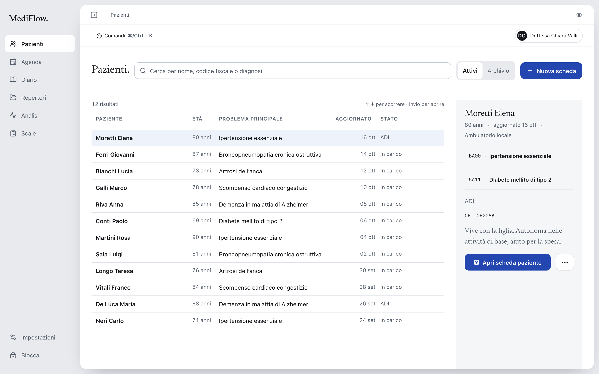
</picture>

*La lista pazienti: un punto da cui riprendere la cartella e il lavoro da
seguire. Schermata del runtime Web locale acquisita il 16 ottobre 2026, con
persone inventate; segue il tema chiaro o scuro del tuo GitHub.*

> **MediFlow 0.9.0: release sorgente per runtime locale Web e Headless.**
>
> Comprende il runtime Web locale e Headless con Node 24, per macOS ARM,
> Windows 11 ARM con Node x64 emulato e Omarchy/Arch ARM su Parallels.
> Le [note 0.9.0](./CHANGELOG.md#090---2026-10-15) distinguono prove accettate,
> quarantene temporanee e limiti. La [pagina GitHub della release](https://github.com/Wulfgardr/mediflow/releases/tag/v0.9.0)
> riporta stato di pubblicazione, commit, artefatti ed esiti CI della consegna.
>
> Dopo il tag sono entrati su `main`, e usciranno con la prossima versione:
> un solo lanciatore per macOS, Windows e Linux; ICD-11 con il catalogo WHO
> incluso, senza Docker; controllo e aggiornamento del catalogo AIFA con un
> clic; protesica con fonti e documenti propri; Ollama 0.40.4; una sola voce
> tipografica nell’interfaccia. Il dettaglio è nel [CHANGELOG](./CHANGELOG.md#non-ancora-rilasciato).
>
> La consegna dei sorgenti non autorizza l'uso con dati clinici reali.
> L'ammissione dell'installazione e dei flussi resta una decisione separata
> del professionista o dell'organizzazione responsabile.

<details>
<summary><strong>Versione sorgente, verifiche e distribuzione</strong></summary>

GitHub fornisce gli archivi ZIP e TAR.GZ del codice sorgente. Per l’avvio qualificato
serve un checkout Git pulito del tag `v0.9.0` con Node 24: gli archivi privi
di `.git` non costituiscono un profilo di avvio qualificato.
App e installer nativi firmati o notarizzati restano fuori da questa release;
i loro metadati seguono il percorso nativo separato.
La [0.8.6 pubblicata il 20 settembre 2026](https://github.com/Wulfgardr/mediflow/releases/tag/v0.8.6)
resta una release storica con le proprie [verifiche e limiti](./docs/analysis/2026-09-07-086-release-verification.md).

Le funzioni AI sono facoltative; i servizi esterni, compresa l'integrazione
ChatGPT, sono spenti per impostazione predefinita e richiedono una scelta
esplicita. Configurare un servizio non dimostra che funzioni; le prove
sintetiche e la pubblicazione dei sorgenti non attestano idoneità clinica.
Ogni verifica conserva la revisione su cui è stata eseguita.

</details>

<details>
<summary><strong>Le terapie, da vicino</strong></summary>

<picture>
  <source media="(prefers-color-scheme: dark)" srcset="./docs/images/getmediflow-090/terapie-dark.png">
  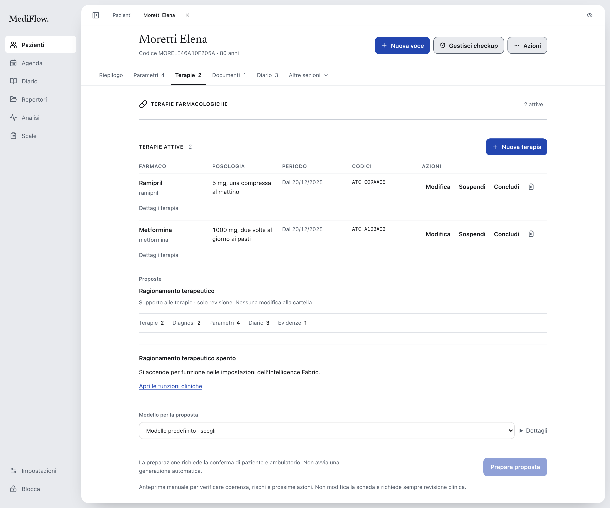
</picture>

Una schermata dell’interfaccia reale, con dati interamente sintetici, mostra
come le terapie restino consultabili nel contesto della cartella. Ramipril
5 mg e il codice ATC C09AA05 sono coerenti; l’esempio non costituisce
un’indicazione terapeutica.

</details>

## Perché nasce

Seguire una persona nel tempo richiede più di una raccolta di campi. Alcune
informazioni hanno bisogno di una codifica, altre di un testo che ne conservi
il contesto; per altre ancora è essenziale poter tornare al referto originale.
MediFlow prova a dare una struttura a questi materiali senza far coincidere
la storia clinica con ciò che è più facile inserire in una tabella.

Per questo il gestionale deve restare utile anche con tutti i modelli AI
spenti. È una scelta di autonomia, ma anche un modo di non imporre dipendenze
a chi lavori con risorse limitate. La configurazione dei modelli resta
legata agli strumenti disponibili sulla singola postazione.

La modularità nasce dalla stessa ragione. Una postazione può aver bisogno di
organizzare cartelle e documenti; un’altra può aggiungere strumenti per
riesaminarli. Il progetto è aperto e gratuito, e intende rimanerlo, perché
possa essere studiato, discusso e migliorato anche dall’esterno. La gratuità
riguarda MediFlow, non l’hardware o gli eventuali servizi di terzi.

### Ordine dove serve. Spazio per ragionare.

La ricerca terminologica, i cataloghi farmaceutici e le scale aiutano a dare
un significato condiviso alle informazioni, purché restino riconoscibili la
fonte e la versione utilizzata. Il catalogo AIFA si può importare da file
locale o aggiornare con **Aggiorna ora**. Con il consenso Internet AIFA,
l’apertura di Repertori verifica soltanto i metadati, al massimo ogni 24 ore;
l’applicazione resta esplicita. Vedi il [manuale](./docs/MANUALE.md#catalogo-farmaci-aifa).
ICD-11 usa il catalogo WHO MMS 2026-01 incluso nell’applicazione, in inglese,
senza Docker, credenziali o rete.

Anche l’esportazione ha un confine preciso: FHIR segue il contratto
dell’[ADR 0081](./docs/adr/0081-fhir-r4-export-v0-contract.md). Un formato
condiviso è una base per lo scambio, non una garanzia di compatibilità con
ogni sistema. La parità FHIRv2 resta da verificare.

## Cosa puoi fare

| Esigenza | Strumento | Confine da conoscere |
| --- | --- | --- |
| Ricostruire la storia | Diario, diagnosi, terapie, misure e contesto amministrativo | Le modifiche sono versionate; un conflitto richiede riesame. |
| Ritrovare l’evidenza | Documenti collegati alla cartella e alle fonti | L’estrazione è locale per i formati supportati; gli errori restano espliciti. |
| Preparare il seguito | Checkup, appuntamenti e attese aperte | Proporre un follow-up non significa averlo eseguito. |
| Dare struttura alle parole | Ricerca terminologica e cataloghi | Catalogo WHO MMS 2026-01 in inglese incluso nell’applicazione; AIFA da file o con **Aggiorna ora**. |
| Registrare una misura | Scale con risposte esplicite | Zero e risposta mancante restano distinti; fonte e versione si conservano nello storico. |
| Riesaminare informazioni complesse | Quattro percorsi Intelligence Fabric | I risultati sono proposte da rivedere, senza scrittura clinica automatica. |
| Accedere alle funzioni senza passare da ogni schermata | Supervisor, AIP e MCP | I permessi sono delimitati; gli adapter non accedono direttamente al database. |

<details>
<summary><strong>Guarda le altre schermate</strong></summary>

<picture>
  <source media="(prefers-color-scheme: dark)" srcset="./docs/images/getmediflow-090/scheda-dark.png">
  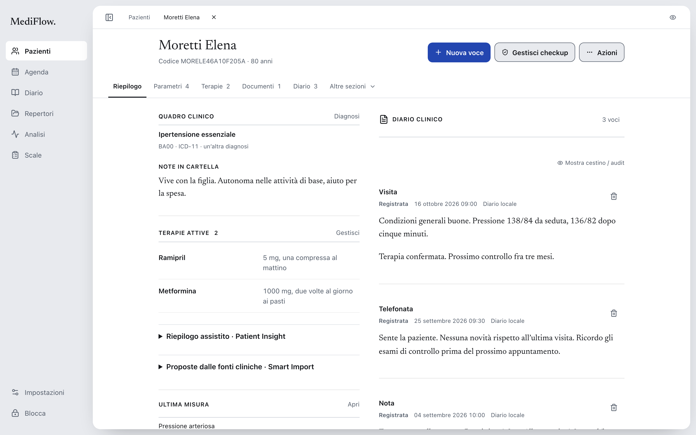
</picture>

La scheda tiene insieme quadro clinico, terapie e diario della stessa persona.

<picture>
  <source media="(prefers-color-scheme: dark)" srcset="./docs/images/getmediflow-090/diario-dark.png">
  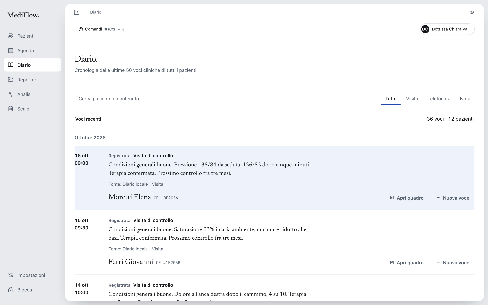
</picture>

Il diario raccoglie le voci di tutti i pazienti, con fonte e stato di ciascuna.

<picture>
  <source media="(prefers-color-scheme: dark)" srcset="./docs/images/getmediflow-090/agenda-dark.png">
  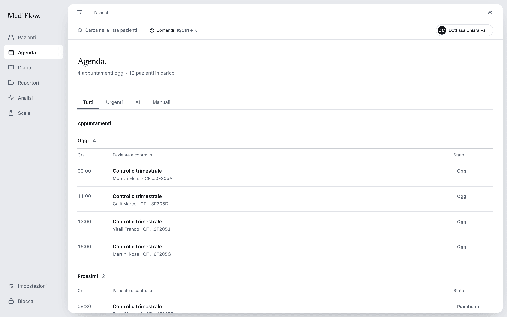
</picture>

<picture>
  <source media="(prefers-color-scheme: dark)" srcset="./docs/images/getmediflow-090/repertori-dark.png">
  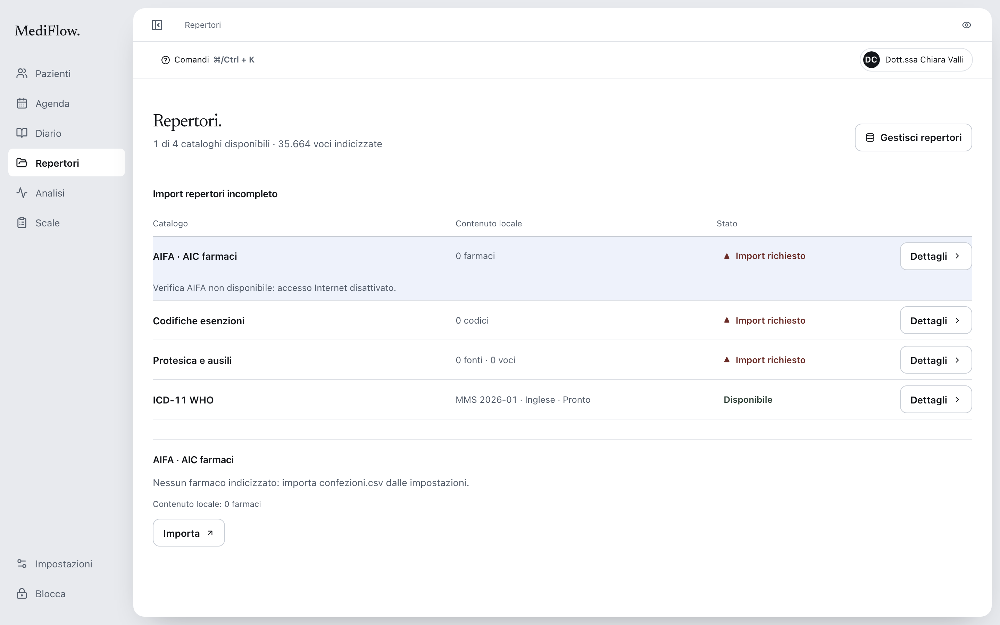
</picture>

I repertori dicono cosa è disponibile in locale e cosa manca: qui il catalogo
AIFA è stato importato dal sito dell’agenzia, ICD-11 è incluso.

<picture>
  <source media="(prefers-color-scheme: dark)" srcset="./docs/images/getmediflow-090/analisi-dark.png">
  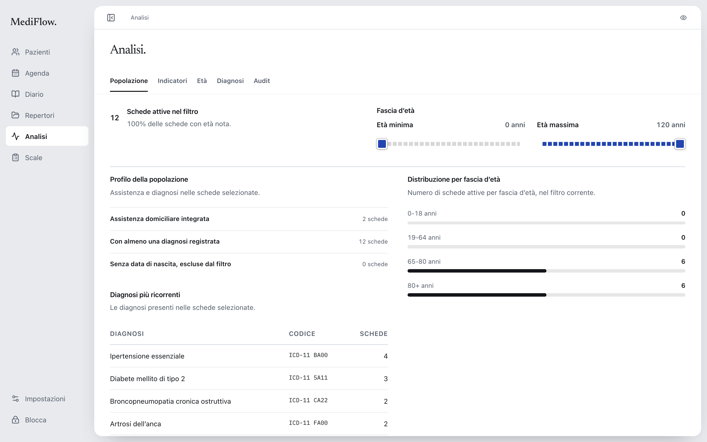
</picture>

<picture>
  <source media="(prefers-color-scheme: dark)" srcset="./docs/images/getmediflow-090/modelli-locali-dark.png">
  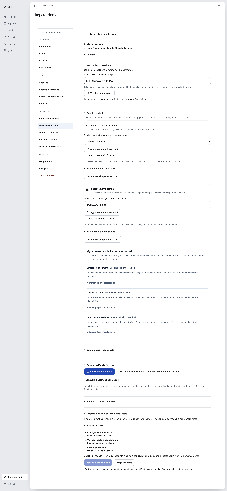
</picture>

Collegare Ollama è un passaggio esplicito: la verifica legge l’elenco dei
modelli e non genera testo. Tutte le schermate usano persone inventate.

</details>

<details>
<summary><strong>Guarda la revisione documentale</strong></summary>

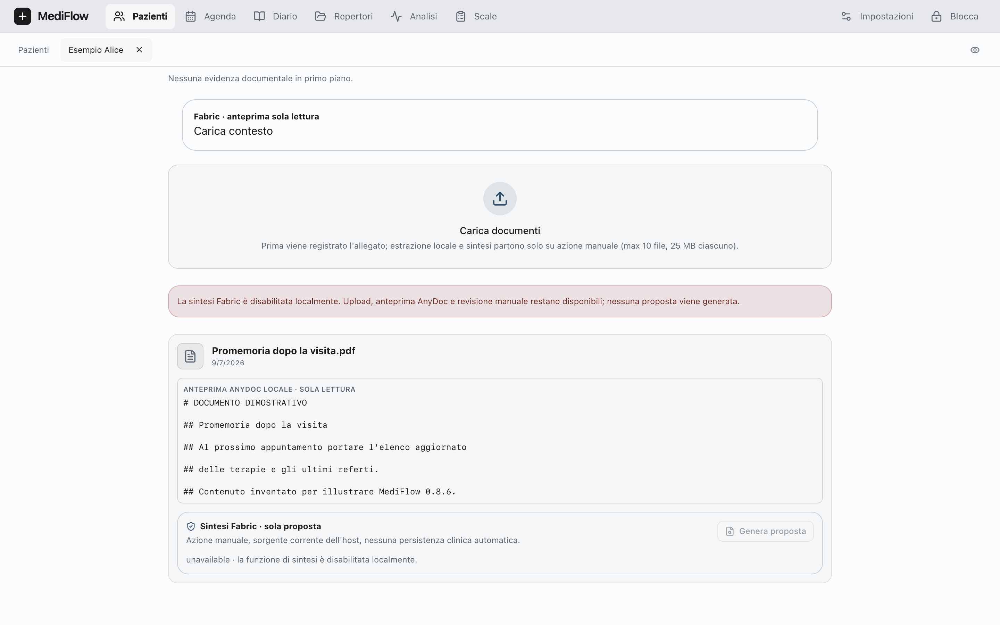

Le fonti restano vicine alle informazioni da riesaminare. Anche qui i dati
sono sintetici: la schermata documentale non dimostra che siano stati eseguiti
un modello AI, un’estrazione AnyDoc o un riconoscimento OCR.

</details>

### Intelligence Fabric, in parole semplici

Si può pensare alla Fabric come a un’impalcatura: una struttura di supporto
che organizza l’uso delle funzioni intelligenti senza rendere obbligatoria
nessuna di esse. La prima scelta resta non usarle. Quando invece servano,
non c’è ragione di chiedere allo stesso strumento di rispondere a ogni esigenza.

Riesaminare una terapia e mettere in relazione documenti diversi sono lavori
differenti. Si può quindi preferire uno strumento locale per una funzione e
valutare un altro modello, eventualmente esterno, per un’altra. È il principio
che orienta il progetto, non la dichiarazione che qualunque combinazione sia
già disponibile o clinicamente validata.

MediFlow distingue quattro percorsi: **Patient Insight** prepara una sintesi
del contesto del paziente; **Smart Import** propone informazioni strutturate
a partire da una fonte; **Document Synthesis** mette in relazione il contenuto
dei documenti; **Treatment Reasoning** accompagna il riesame professionale in
un percorso dedicato. In tutti i casi il risultato rimane una proposta.

La configurazione dà forma a questa scelta entro limiti precisi. Si possono
usare soltanto le opzioni del catalogo ammesso dal sistema locale, l’*host*;
un modello assente o non più valido non viene sostituito di nascosto. Le
preferenze per funzione e per singola richiesta seguono ADR0129: non sono
un’autorizzazione a scegliere liberamente provider, endpoint o modalità d’invio.

Ollama può servire i primi tre percorsi, mentre ATHENA/MLX è opzionale e
riservata a Treatment Reasoning, con configurazione e verifiche locali proprie.

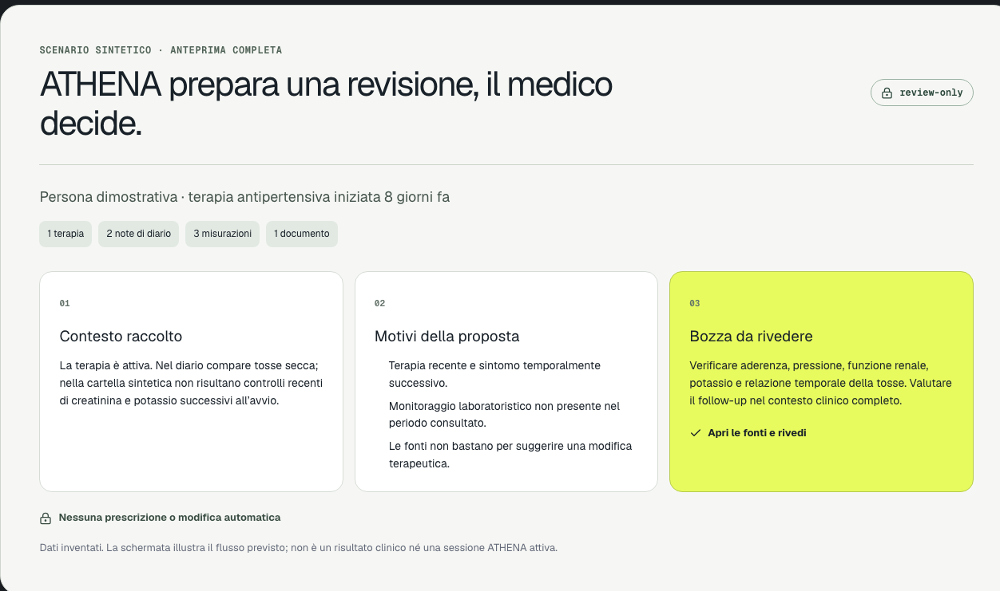

La riproduzione riprende il pannello MediFlow nello stato riuscito e usa un
caso interamente sintetico con sei terapie e relativi codici ATC. Il percorso
interattivo completo su [Get MediFlow](https://getmediflow.dev/#fabric)
permette di fermarsi su modello, fonti, bozza, preparazione e revisione.
Treatment Intelligence rende leggibili raccomandazione, dati mancanti,
evidenze, cautele, provenienza e tre percorsi proposti: follow-up
dell’ACE-inibitore, riconciliazione terapeutica e rivalutazione del sintomo.
ATHENA prepara soltanto il testo della revisione; il medico può usarlo,
correggerlo o scartarlo, mentre terapie, percorsi e cartella restano invariati.

L’integrazione ChatGPT resta opzionale e spenta per impostazione predefinita.
Il percorso esterno richiede configurazione, consenso e controlli pertinenti
all’operazione; non viene dichiarata una nuova prova live di account/provider
consumer sul candidato finale. Collegare un account ChatGPT non equivale a
possedere accesso alle API OpenAI, né dimostra l’idoneità all’uso con dati
clinici reali.

<details>
<summary><strong>Perché una proposta non è ancora una modifica</strong></summary>

Una risposta è utile se si può capire da dove venga e se le fonti a cui si
riferisce siano ancora valide. Ogni percorso conserva perciò provenienza,
ricevuta e controlli di attualità. Queste evidenze permettono di riesaminare
il risultato, ma non gli attribuiscono il diritto di scrivere nella cartella.

Le operazioni protette mantengono controlli propri di ruolo, contesto,
conferma e audit. Anche gli agenti usano comandi MediFlow nominati, dopo
l’autenticazione e nei permessi assegnati; non aprono direttamente il database.
Il sistema verifica che dati e autorizzazioni siano ancora validi, richiede
la conferma pertinente prima delle scritture cliniche e restituisce una
ricevuta dell’esito.

[Confini Fabric e headless](./docs/adr/0117-headless-portable-agent-first-and-capability-first-fabric.md).

</details>

<details>
<summary><strong>Provider esterni e offuscamento: condizioni e limiti</strong></summary>

Scegliere un servizio esterno significa anche valutare quali informazioni
possano uscire. Il percorso documentato minimizza il contenuto, sostituisce
gli identificativi e riconcilia il risultato in locale. Non è una protezione
da presumere disponibile per ogni funzione: il testo narrativo clinico resta
bloccato finché non siano soddisfatti i controlli richiesti. Per i percorsi
ordinari ChatGPT, report e installazione del sistema di oscuramento dei dati identificativi,
se mancanti o incoerenti, impediscono l’invio, senza passaggi alternativi impliciti.

Pseudonimizzare non significa anonimizzare. I dati riconducibili a una persona
restano soggetti al GDPR; la presenza di un adapter non rende pronto all’uso
clinico un servizio cloud.

[Matrice dei runtime](./docs/ai-runtime-serving-matrix.md) ·
[Decisione sul confine egress](./docs/adr/0077-ai-provider-abstraction-and-egress-anonymization-boundary.md)

</details>

## Dati sanitari e responsabilità

Conservare le fonti, delimitare gli accessi e richiedere una revisione umana
sono scelte del progetto. La valutazione di un impiego concreto deve però
considerare anche finalità, ruoli, base giuridica, sicurezza e obblighi
applicabili. Il funzionamento locale non dimostra da solo la conformità, e
la supervisione umana non è una certificazione.

[GDPR, AI Act e scelte di progetto](./docs/privacy-and-ai-governance.md).

## Dove stanno i dati

Nella 0.8.6 il Mac conserva il database autorevole SQLite e ospita servizi e
API; il browser su localhost è l’interfaccia di riferimento. L’app Mac resta
uno sviluppo separato. Il principio locale va letto insieme ai percorsi
espliciti di pairing, cache, esportazione e backup, non come promessa che
ogni dato sia confinato per sempre a un solo dispositivo.

All'apertura su macOS e Linux, i file del database appartenenti all'utente
sono resi accessibili solo a quell'utente. Se il controllo dei permessi fallisce,
l'apertura si ferma e l'archivio va conservato per la verifica. Verifica e ripristino web ricevono
il backup completo, inclusi originali e allegati paziente, senza il limite
del proxy previsto per un singolo upload. Il JSON viene elaborato in memoria:
la dimensione gestibile dipende dalle risorse del computer.

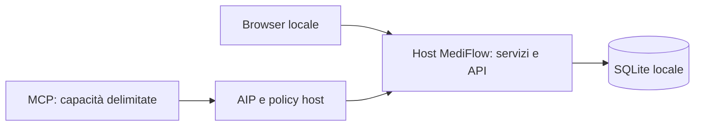


Gli adapter non aprono direttamente SQLite. La cifratura protegge i campi
clinici sensibili secondo il contratto documentato: non è una dichiarazione
di cifratura integrale di ogni metadato o dell’intero file database.

Preferenze e ricevute del lanciatore sono separate per cartella sorgente nella
configurazione utente: `~/Library/Application Support/MediFlow/launcher` su
macOS, `%APPDATA%\MediFlow\launcher` su Windows e
`$XDG_CONFIG_HOME/mediflow/launcher` oppure `~/.config/mediflow/launcher` su Linux.
Il lanciatore non le scrive nella cartella scelta con `MEDIFLOW_DATA_DIR`.
Il primo avvio tollera soltanto le voci di servizio elencate nell'[ADR 0138](./docs/adr/0138-explicit-data-directory-bootstrap.md#emendamento-2026-10);
altre voci senza database richiedono un recupero esplicito.

[Topologia dei dati](./docs/topologia-dati-flussi.md) ·
[Sicurezza](./SECURITY.md) · [Limiti noti](./docs/known-limitations.md)

## Provalo

Per partire dai sorgenti servono Git, **Node.js 24.x** e le dipendenze del
progetto. Per valutazione e sviluppo usa fixture sintetiche.

```sh
git clone https://github.com/Wulfgardr/mediflow
cd mediflow
nvm use
npm ci
```


`nvm use` serve soltanto con nvm; altrimenti seleziona Node 24 con il tuo
gestore. `better-sqlite3` deve corrispondere all’ABI del Node attivo.

| Sistema | Doppio clic nella cartella del progetto |
| --- | --- |
| macOS | `MediFlow.command` |
| Windows | `MediFlow.cmd` |
| Linux | `MediFlow.sh` (eseguibile; l'apertura dipende dal file manager) |

Il browser chiede come vuoi usare MediFlow: **Nel browser**, **Per un agente**
oppure, su macOS, **App per Mac** se l'app è già costruita. La scelta si può
ricordare. La prima volta per ogni versione MediFlow prepara la build di
produzione e ne mostra l'avanzamento. Il terminale conserva i log: lascialo
aperto; **Ctrl+C** o **Arresta** chiudono i processi di questo avvio. L'accesso per agenti mantiene i controlli e le autorizzazioni
esistenti e riserva lo standard output al protocollo del client.

Il lanciatore propone `npm ci` se mancano le dipendenze, chiedendo conferma
prima di accedere al registro npm. Usa sempre la produzione: quando manca una
build verificata della revisione corrente, esegue `npm run build`. La prima
preparazione può richiedere diversi minuti. Con modifiche non committate,
la produzione si ferma e si può scegliere esplicitamente **Apri per sviluppo**.

**Ricorda la mia scelta** evita di scegliere al prossimo avvio. **Cambia**
nella pagina di attesa riapre le scelte; dal terminale usa:

```sh
node scripts/mediflow.mjs --scegli
node scripts/mediflow.mjs --scelta web --senza-browser
# Solo Linux, facoltativo: aggiunge MediFlow al menu applicazioni
node scripts/mediflow.mjs install-desktop-entry
```

Senza display o quando il browser non si apre, compare un menu nel terminale.
Senza terminale interattivo usa `--scelta` e `--senza-browser`. Il server web
usa `http://127.0.0.1:3000` (oppure `PORT`); la pagina Avvio usa una porta libera.
Il riuso richiede la ricevuta di questa cartella e il fingerprint del server.
Un'altra istanza non viene arrestata né adottata. `main` si ferma se mancano
aggiornamenti già noti a Git, senza scaricarli. Ollama, se installato, parte
in background senza ritardare l'apertura.

Questi ingressi appartengono al sorgente corrente; il tag `v0.9.0` conserva
i suoi ingressi originali. Il lanciatore non attiva provider AI, servizio WHO
o altri connettori opzionali. Non è un installer con Node incluso e non
certifica la parità nativa su Windows e Linux. Le evidenze per piattaforma
restano nello [stato del sistema](./docs/STATE_OF_THE_SYSTEM.md).

<details>
<summary><strong>Apple: account gratuito, Xcode e distribuzione</strong></summary>

Per compilare e testare le applicazioni Apple serve Xcode completo: le sole
Command Line Tools non coprono SwiftUI e XCTest. Sono verifiche del seguito
nativo, non condizioni di consegna della release sorgente 0.9.0.

Un Apple Account gratuito consente sviluppo e prove personali entro i limiti
del Personal Team; Developer ID e notarizzazione Mac richiedono l’Apple
Developer Program. Non sono prerequisiti per pubblicare il codice sorgente.

[Guida nativa](./docs/NATIVE.md) ·
[Verifiche e limiti della candidata 0.8.6](./docs/analysis/2026-09-07-086-release-verification.md) ·
[Confronto ufficiale Apple](https://developer.apple.com/support/compare-memberships/)

</details>

## Per chi sviluppa

La repository operativa è soltanto [`Wulfgardr/mediflow`](https://github.com/Wulfgardr/mediflow).
Quella privata precedente è archiviata. Codice pubblicabile e documenti vivono
qui, senza un passaggio di esportazione private-to-OSS; database, credenziali,
fonti riservate e risultati clinici restano fuori da Git.

[Topologia repository](./docs/repository-topology.md) ·
[Architettura](./ARCHITECTURE.md) · [Contribuire](./CONTRIBUTING.md)

<details>
<summary><strong>Headless: cosa parte e cosa non autorizza</strong></summary>

**Mini e accesso headless sono percorsi distinti.** Mini è la versione a riga
di comando prevista nella roadmap 1.0. L’accesso headless è invece il contratto
con cui un client agente autorizzato può usare capacità nominate di MediFlow;
Codex è mostrato soltanto come uno dei client possibili.

```sh
npm run build -- --webpack
npm run mcp:intelligent-host:production
```


Usare MediFlow senza attraversare le schermate non significa aggirarne i
controlli. Il Supervisor mantiene Web e MCP come processi figli separati sul
Mac; MCP comunica tramite stdio. Per una funzione riferita al paziente servono
autenticazione, selezione e attivazione esplicita nell’interfaccia fidata.
Revoca, logout, cambio di selezione o scadenza chiudono l’autorizzazione, il
*grant*, senza trasferirla all’agente.

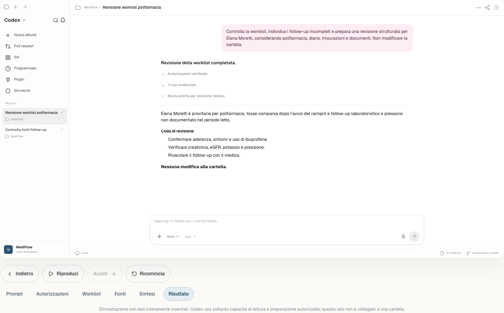

La schermata racconta una richiesta che non si risolve consultando una singola
pagina: il client verifica le capacità concesse, scandisce una worklist,
incrocia polifarmacia, diario, misurazioni e documenti, quindi prepara una coda
di revisione senza scrivere nella cartella. Su
[Get MediFlow](https://getmediflow.dev/#cofano) l’animazione può essere messa in
pausa, percorsa avanti e indietro o riavviata. È una dimostrazione con dati
inventati: non è una sessione Codex collegata e non prova disponibilità nella
release 0.8.6.

Questo accesso non concede un diritto generale sul database o scritture
cliniche fuori dai controlli applicabili. La 0.8.6 non richiede né qualifica
un client agente specifico: si usano soltanto i comandi MediFlow nominati.
Anche il pianificatore semantico resta limitato agli strumenti approvati.

</details>

## Documentazione

| Per… | Parti da… |
| --- | --- |
| Conoscere il progetto senza leggere il codice | [Get MediFlow](https://getmediflow.dev) |
| Distinguere implementazione e prove ancora necessarie | [Stato del sistema](./docs/STATE_OF_THE_SYSTEM.md) e [verifiche della candidata 0.8.6](./docs/analysis/2026-09-07-086-release-verification.md) |
| Individuare il documento di riferimento di un tema | [Mappa della documentazione](./docs/README.md) |
| Capire ruoli delle piattaforme e parità | [Guida nativa](./docs/NATIVE.md) e [matrice di parità](./docs/parity-matrix.md) |
| Ricostruire una decisione tecnica | [ADR](./docs/adr/README.md) |
| Capire come viene presentato il prodotto | [Get MediFlow e linea editoriale](./docs/getmediflow-editorial-proposal.md) |
| Trovare un documento preciso | [Indice completo](./docs/markdown-index.md) |

I percorsi SISS/FSE restano passaggi assistiti verso i canali ufficiali,
indicati come handoff o `webapp-assisted`. L’export FHIR segue ADR0081;
la parità FHIRv2 resta da verificare.

## Sviluppo assistito

MediFlow è sviluppato con l’assistenza di **Codex e Claude Code** per
progettazione, implementazione, revisione e verifica. Direzione e
responsabilità del progetto rimangono dell’autore.

<details>
<summary><strong>Disclosure e storico dei token per provider, modello ed effort</strong></summary>

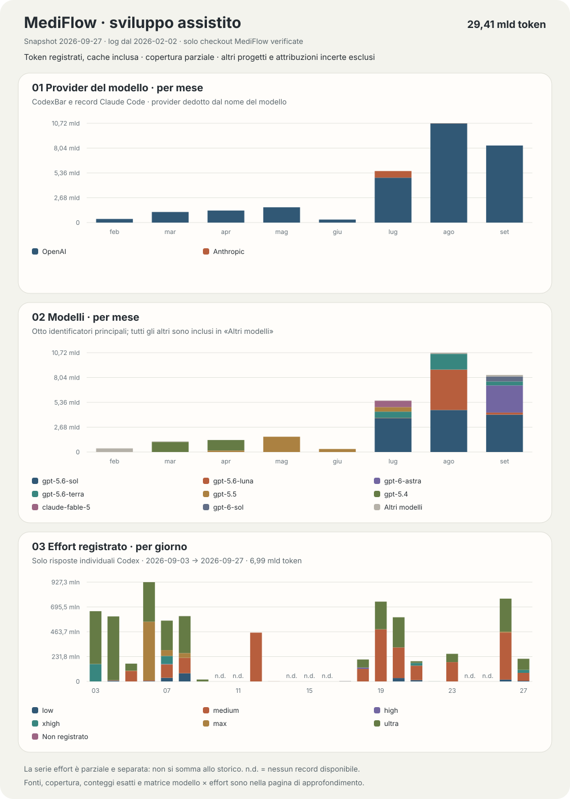

Lo storico include solo registrazioni associate alle **checkout verificate di
MediFlow**, cache inclusa. Altri progetti e attribuzioni incerte sono esclusi:
la copertura è parziale e i token non misurano costo o qualità del codice.
Il provider è dedotto dall’identificatore del modello e resta distinto
dall’ambiente che registra l’uso. L’effort compare solo dove è registrato,
in una serie con copertura propria che non si somma ai totali storici.

[Fonti, copertura, tabelle complete e dati riproducibili](./docs/development-usage.md)
· [Crediti degli strumenti](./CREDITS.md#sviluppo-assistito).

</details>

## Licenza e contributi

Il codice è pubblicato sotto [licenza MIT](./LICENSE), perché sia possibile
esaminarlo e contribuire al suo sviluppo. Dataset, terminologie, modelli e
fonti esterne conservano le rispettive condizioni d’uso: la licenza di
MediFlow non le sostituisce. [Crediti e attribuzioni](./CREDITS.md).


Il repertorio protesica supporta fonti personali distinte, originali locali e
snapshot di provenienza nelle nuove prescrizioni scelte dal catalogo. Importa
CSV UTF-8 con virgola o punto e virgola e mappatura colonne; per XLSX occorre
prima esportare in CSV. Catalogo, originali e snapshot di provenienza sono in
chiaro nel database locale. Vedi [manuale](docs/MANUALE.md#fonti-personali-della-protesica).

Il [catalogo ICD-11 incorporato](docs/icd-who-setup.md) cerca categorie per codice
o titolo inglese in SQLite. Dati WHO CC BY-ND 3.0 IGO, separati dalla licenza MIT:
nessun sinonimo o postcoordinazione dell’API, nessuna scrittura clinica automatica.
Il bundle include l’archivio WHO ufficiale non modificato e il manifest verificato:
35.664 categorie con codice. Il primo uso lo importa nel DB di repertorio dedicato.
