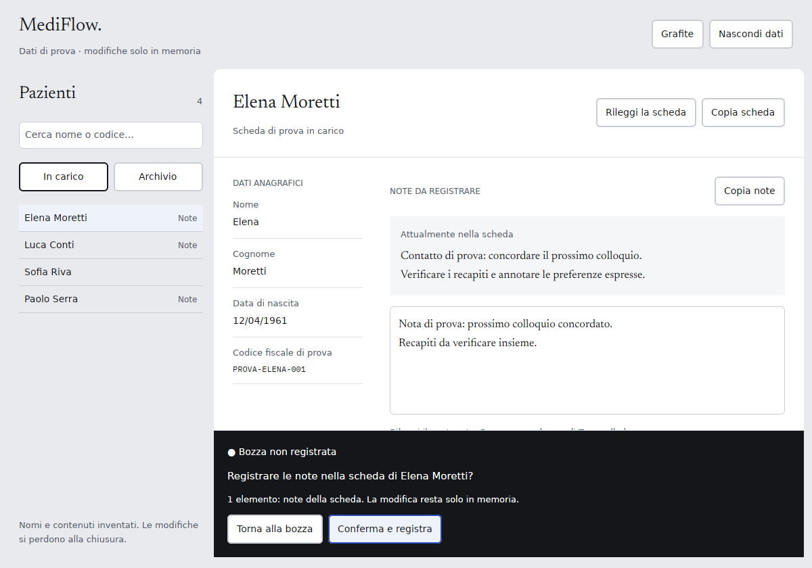
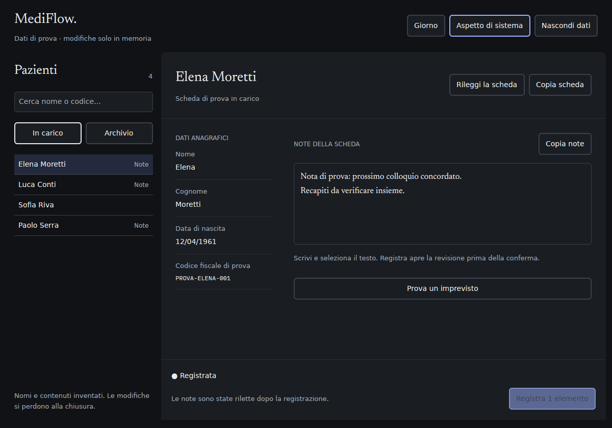

# MediFlow: pilota paziente Rust / GPUI

Una piccola applicazione desktop nativa per provare il percorso
**elenco → scheda paziente → note → revisione → conferma → rilettura**.
Il client e l'interfaccia sono Rust; GPUI disegna la finestra. I cinque pazienti
sono inventati e il servizio di prova conserva le modifiche soltanto in memoria.
La chiusura del processo ripristina le fixture al successivo avvio.

Il pilota contribuisce a [WUL-706](https://linear.app/wulfgardr/issue/WUL-706)
e [WUL-714](https://linear.app/wulfgardr/issue/WUL-714). Il
[verbale del 17 ottobre](../../docs/analysis/2026-10-17-rust-gpui-patient-pilot.md)
riporta prove e limiti. Per il collegamento futuro ai dati del prodotto,
la [baseline cifrata WUL-574](../../docs/analysis/2026-10-17-patient-notes-pilot.md)
esercita separatamente gli ingressi Web/API v1 esistenti.

## Schermate della prova Linux

Revisione esplicita, prima della conferma:



Note rilette dopo la conferma, in Grafite:



Sono catture del binario locale su X11/Xvfb. I
[digest di sorgenti, binario e immagini](./evidence/local-verification.json)
identificano la prova; non qualificano altri sistemi o un pacchetto installabile.

## Avvio

Dal checkout completo della repository, con Rustup disponibile:

```bash
cd experiments/gpui-patient-pilot
cargo run --locked -p mediflow-gpui-patient-pilot
```

`rust-toolchain.toml` installa/seleziona Rust **1.98.1**. Il primo build scarica
le dipendenze fissate da `Cargo.lock` e richiede accesso ai repository Git
upstream. I font e i token grafici sono incorporati dal checkout MediFlow.
Non occorre avviare Node, creare un account o scegliere una directory clinica.

| Sistema | Prerequisiti del build |
| --- | --- |
| Linux | Compilatore C/C++, `pkg-config`, Fontconfig, GLib, Wayland, X11/XCB e xkbcommon; un display X11/Wayland e un renderer compatibile per aprire la finestra. |
| macOS | Xcode e strumenti a riga di comando, incluso il compilatore Metal. |
| Windows | Toolchain Rust MSVC e strumenti C++/Windows SDK richiesti dal linker. |

Su Ubuntu 24.04, le dipendenze di compilazione usate dalla CI sono:

```bash
sudo apt-get install clang pkg-config libfontconfig-dev libglib2.0-dev \
  libwayland-dev libx11-xcb-dev libxkbcommon-x11-dev
```

Questi comandi preparano il sorgente. La matrice CI compila e testa i tre
target; la prova di una finestra e la distribuzione installabile sono attività
distinte, registrate nel verbale quando effettivamente eseguite.

## Percorso da provare

1. Aprire una scheda dall'elenco. La ricerca filtra per nome e codice di prova;
   «Archivio» mostra la fixture archiviata in consultazione.
2. Modificare le note, anche su più righe. La bozza resta legata alla scheda:
   un cambio paziente non la elimina implicitamente.
3. «Registra 1 elemento» apre la revisione. «Torna alla bozza» consente di
   correggere il testo; «Conferma e registra» invia una sola modifica.
4. Il servizio di prova applica il confronto della versione e risponde.
   Il client mostra «Registrata» soltanto dopo una nuova lettura che contiene
   esattamente la versione successiva e le note confermate.
5. «Prova un imprevisto» prepara, per il prossimo invio, un conflitto,
   un rifiuto, un esito incerto oppure una rilettura non disponibile.
   Nei casi incerti/conflitto la bozza resta copiabile e l'invio non viene
   ripetuto automaticamente. Lo scarto richiede una conferma esplicita.

«Nascondi dati» svuota la selezione e il contenuto dell'editor, chiedendo prima
lo scarto di una bozza. È un controllo della prova in memoria, non un accesso
autenticato o una garanzia di cancellazione fisica della memoria/clipboard.
«Copia note» e «Copia scheda» scrivono negli appunti di sistema su richiesta.

| Tastiera | Azione |
| --- | --- |
| Tab / Maiusc+Tab | Percorre i controlli. |
| Ctrl+K, oppure Cmd+K su macOS | Porta il focus alla ricerca. |
| Alt+↑ / Alt+↓ | Cambia scheda, se non c'è lavoro da conservare e i dati sono visibili. |
| Ctrl+Invio, oppure Cmd+Invio su macOS | Apre la revisione; in revisione conferma, se non è aperta una richiesta di scarto. |
| Esc | Torna dalla revisione alla bozza o chiude la richiesta di scarto. |
| Invio nell'editor | Inserisce una riga. |
| Ctrl/Cmd+A, C, X, V, Z, Maiusc+Z | Selezione, appunti e annulla/ripeti nell'editor. |

Sono presenti Giorno/Grafite e il ritorno all'aspetto del sistema. I colori
provengono direttamente dai
[token Punto d'inchiostro](../../docs/design/punto-inchiostro/tokens/punto-inchiostro.tokens.json);
Newsreader e IBM Plex Mono sono gli asset già presenti nella repository.

## Confini del codice

| Componente | Responsabilità |
| --- | --- |
| `client/src/lib.rs` | Stato di selezione, bozza, revisione, correlazione delle richieste, esiti e rilettura. Non dipende da GPUI. |
| `app/src/main.rs` | Composizione della finestra, focus, azioni e collegamento dello stato al servizio sintetico. |
| `app/src/demo.rs` | Cinque fixture in memoria e scenari deterministici. Non accede a rete, file, credenziali o SQLite. |
| `app/src/text_input.rs` | Editor locale, selezione Unicode, composizione, appunti e cronologia limitata. |
| `app/src/theme.rs` | Lettura dei token inclusi al build e adattamento alle piattaforme. |

Il client non possiede autorizzazione, chiavi, cifratura, audit o transazioni.
I ticket correlano una risposta alla stessa istanza, richiesta e paziente:
non sono credenziali. Il DTO `PatientProfile` è una proiezione del pilota,
non il deserializzatore completo delle route correnti. Il body notes-only
serializza `{ "version": ..., "notes": ... }`, mantenendo l'ID nel percorso
e il limite degli interi sicuri JavaScript. Le note della demo sono testo
inventato in chiaro; un adapter reale dovrà rispettare il contratto cifrato
e la custodia delle chiavi del servizio accettato.

Il limite di 262.144 unità UTF-16 dell'editor e la consultazione della fixture
archiviata delimitano questa prova. Non cambiano il contratto HTTP o le
regole del writer corrente. Non vengono aggiunti un database, un protocollo
IPC applicativo, un secondo writer o un nuovo punto di accesso al prodotto.

## Verifica

Dal percorso del pilota:

```bash
cargo fmt --all --check
cargo test --workspace --all-targets --locked
cargo clippy --workspace --all-targets --locked -- -Dwarnings
```

`cargo test --locked` senza `--workspace` esegue soltanto il client, membro
predefinito utile per lavorare sulla macchina a stati. La CI usa sempre il
comando completo. Il controllo repository `node scripts/check-test-selection.mjs`
verifica che manifest, moduli e comando CI selezionino davvero i test.

Il servizio sintetico verifica la semantica della demo. Il test HTTP
`scripts/patient-notes-pilot-http.test.mjs`, già incluso nel runner clinico,
verifica separatamente il writer esistente con cifratura reale e SQLite
sintetico. I due test non dimostrano un collegamento Rust/HTTP già realizzato.

## Dipendenze e licenze

GPUI e `gpui_platform` usano lo stesso commit Zed
[`56934ec0560bce8929025497411de7f5322fb6ca`](https://github.com/zed-industries/zed/tree/56934ec0560bce8929025497411de7f5322fb6ca).
Il numero `0.2.2` da solo non identifica queste API: qui il punto di ingresso
è `gpui_platform::application()`. Le patch Git nel manifest riproducono i
pin upstream necessari, poiché le patch del workspace di una dipendenza
non vengono ereditate automaticamente dal workspace consumatore.

GPUI e i backend usati sono Apache-2.0. Il widget di testo deriva dall'esempio
GPUI con attribuzione e modifiche indicate in sorgente e in [NOTICE](./NOTICE);
la licenza è in [LICENSE-APACHE-GPUI](./LICENSE-APACHE-GPUI).
Non sono importati i widget GPL del crate Zed `ui`. I font mantengono i
rispettivi file OFL già presenti in `app/fonts` e nella directory font nativa.
`Cargo.lock` fissa anche le dipendenze transitive; questa nota non è un SBOM
del futuro pacchetto installabile.

Il rollback della prova consiste nell'arrestare il binario e rimuovere questo
workspace e il suo workflow. Non occorre migrare o ripristinare dati clinici.
